<p align="center">
  <a href="https://balaurbyte.com">
    
  </a>
</p>

**BalaurByte** is an offensive security company based in Romania, working internationally. We test whatever you build and run: if you can put it in scope, we test it. We validate the impact of what we find and deliver a report your engineers can act on.

## Where engagements usually start

| ID | Assessment | ID | Assessment |
| :-- | :-- | :-- | :-- |
| `01` | [Penetration testing](https://balaurbyte.com/penetration-testing) | `05` | [AI / LLM security testing](https://balaurbyte.com/ai-llm-security-testing) |
| `02` | [API security testing](https://balaurbyte.com/api-security-testing) | `06` | [Mobile app penetration testing](https://balaurbyte.com/mobile-app-penetration-testing) |
| `03` | [Cloud security testing](https://balaurbyte.com/cloud-security-testing) | `07` | [Red team assessment](https://balaurbyte.com/red-team-assessment) |
| `04` | [Kubernetes security testing](https://balaurbyte.com/kubernetes-security-testing) | `08` | [Secure code review](https://balaurbyte.com/secure-code-review) |

## What we have tested

That table is a starting point, not a limit. Systems we have tested include:

- Multi-tenant SaaS platforms and their REST, GraphQL and WebSocket APIs
- iOS and Android apps, down to analysis of the app binary
- MCP servers, LLM agents and AI assistants
- Internal and external corporate networks
- Crypto wallets, gaming and lottery platforms
- Point-of-sale systems and payment flows
- Healthcare, identity verification (KYC) and e-invoicing platforms
- Applications assembled from no-code and third-party services

Not on the list? [Tell us what it is](https://balaurbyte.com/contact).

## How an engagement runs

<p align="center">
  <a href="https://balaurbyte.com/methodology">
    
  </a>
</p>

You receive a technical report and an executive summary. After your team fixes the reported issues, we retest them within the agreed scope. NDA available. Reports in English or Romanian.

## Start here

- [Request a quote](https://balaurbyte.com/contact)
- [How to prepare for a penetration test](https://balaurbyte.com/resources/pentest-scoping-checklist)
- [Illustrative penetration testing report](https://balaurbyte.com/resources/illustrative-pentest-report)
- [Pentest, vulnerability scan or security audit?](https://balaurbyte.com/resources/pentest-vulnerability-scan-audit)
- [security.txt](https://balaurbyte.com/.well-known/security.txt)

```text
                   _  ,
                ___\BD|A\
               __,7B284F4,_
               _,8CC194B75EB,__
               _,393E|'5""""BD'
       /|_,/    /F0AF|        _ \, |\
      0D5D,C",_ \|C152       _,D1/D,9,
   /700A356753//  |AD72\    /,38492E51C6\
/,132F4E0 '080C7| |48BE5\  |9F573' 656731ED\
 ""'  ''    784FE 8659044\ |CC7A    ''  '"'
           /961C9/D08D1EDA\77AAB\
          /46DE837BF1034A177F2014\
         /8CED21547C4A68F12E0\7D75\
         ""E1"55B56EACB0EBD34E\86""
             'B9A9D2A95E8D9761'
               \D519879B3BBE/
                 \2971075F/
                   8D7093
                    CCBC
                     0E
                     ||
                     ||

  balaur (ro) n. many-headed dragon of Romanian folklore
```

<sub>BalaurByte SRL | Romania | Working internationally. Scope, boundaries and deliverables are agreed before any testing begins.</sub>
